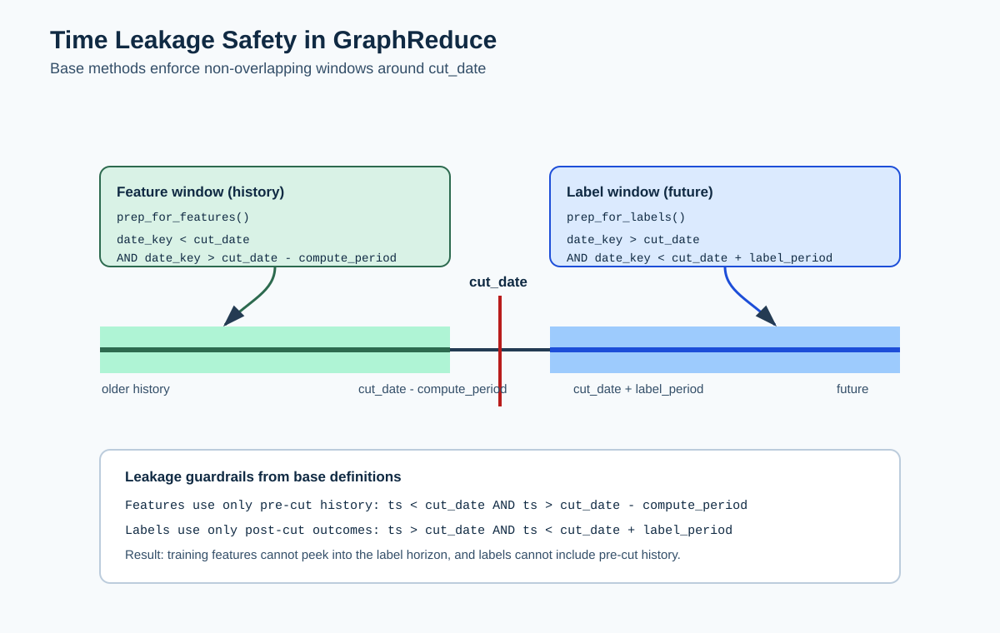

# Time Windows and Leakage Safety

GraphReduce divides dated rows around a cutoff `T`:



```text
feature window                         label window
(T - compute period, T)                (T, T + label period)
──────────────────────●────────────────●──────────────────
          past                         T          future
```

For non-null timestamps, the base implementation uses strict comparisons. A
row exactly at `T`, at the history start, or at the label-window end is
excluded.

## Configuration

| Setting | Meaning |
| --- | --- |
| `cut_date` | Point in time at which features are evaluated |
| `compute_period_val` + `compute_period_unit` | How far backward feature rows may extend |
| `label_period_val` + `label_period_unit` | How far forward label rows may extend |
| Node `date_key` | Timestamp column used to filter that node |

Graph-level values are pushed into nodes during graph hydration, keeping the
cutoff and windows consistent across the graph.

## Exact base-class contract

For a dated node, `prep_for_features()` applies:

```text
cut_date - compute_period < date_key < cut_date
```

`prep_for_labels()` applies:

```text
cut_date < date_key < cut_date + label_period
```

Undated nodes are not filtered by these helpers. Set `date_key` on every node
whose rows become available over time.

The dataframe feature path currently retains rows whose configured `date_key`
is null, while SQL `WHERE` comparisons normally exclude them. Labels exclude
null timestamps. Decide whether unknown timestamps are valid for your problem,
and filter them explicitly when you need identical behavior across backends.

## Example

With a cutoff of `2024-01-01`, a 365-day compute period, and a 30-day label
period:

- features can use rows after `2023-01-01` and before `2024-01-01`;
- labels can use rows after `2024-01-01` and before `2024-01-31`; and
- a row stamped exactly `2024-01-01` belongs to neither window.

## Leakage checklist

- Use the timestamp that represents **availability**, not merely when a source
  event happened.
- Declare a `date_key` for every time-varying node.
- Confirm timezone and timestamp precision before comparing boundaries.
- Define and test a policy for null timestamps.
- Keep label-derived and future-derived fields out of the feature graph.
- Fit schema profiles and category selections using training data only.
- Inspect the minimum and maximum timestamps in a small materialized result.
- Build multiple cutoffs for backtesting instead of making a random row split
  across one temporal snapshot.

GraphReduce can enforce configured time boundaries, but it cannot infer when a
business value truly became knowable. That remains part of the dataset's
semantic contract.

See [Point-in-time tutorial](../tutorial_time.md) for an executable check.
