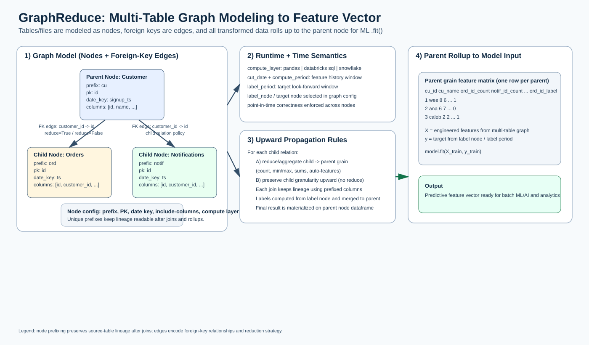

# GraphReduce

GraphReduce builds model-ready feature tables from relational data. A graph
describes which tables are related, how they join, and which entity defines the
final row grain. GraphReduce executes the graph from the leaves upward,
reducing one-to-many relations before joining them into their parents.

The result is a reproducible alternative to maintaining a large, hand-written
chain of joins and aggregations for every ML project.

## Start here

New users should follow this path:

1. Read the [fundamentals](fundamentals/index.md) for the graph model.
2. Run the [quickstart](tutorial_index.md) from a repository checkout.
3. Review [time windows](fundamentals/time_and_leakage.md) before creating a
   training dataset.
4. Choose an [end-to-end example](end_to_end_examples/index.md) that matches
   your backend or modeling goal.

If you already understand the basics, use these direct routes:

| Goal | Read |
| --- | --- |
| Define custom dataframe logic | [Custom node operations](tutorial_custom_graph.md) |
| Look up graph, node, or edge settings | [Configuration reference](configuration.md) |
| Understand joins and output grain | [Joins and cardinality](fundamentals/joins_and_cardinality.md) |
| Use DuckDB or another SQL backend | [SQL backends](tutorial_sql_backends_dynamic_queries.md) |
| Configure automatic SQL features | [SQL auto-feature families](sql_auto_feature_families.md) |
| Reuse a generated SQL plan | [Frozen SQL plans](tutorial_frozen_sql_plans.md) |
| Compare complete workflows | [End-to-end examples](end_to_end_examples/index.md) |

## The graph model



A GraphReduce graph has three parts:

- A **node** represents one table or file and owns its data operations.
- An **edge** represents a key relationship and its reduction behavior.
- The **parent node** defines the intended output grain.

For a customer-to-orders edge, `reduce=True` means “aggregate orders by their
customer foreign key, then join the aggregates to customers.” This avoids the
row multiplication that a raw one-to-many join would create.

## Time semantics

For a cutoff time `T`, GraphReduce separates feature and label data:

```text
feature rows                       label rows
(T - history, T)                   (T, T + horizon)
───────────────●───────────────────●───────────────
               history start       T
```

For non-null timestamps the boundaries are strict: rows exactly at `T` are
excluded from both windows. Every time-varying node needs a valid `date_key`;
otherwise GraphReduce cannot apply point-in-time filtering to that node.

See [Time windows and leakage safety](fundamentals/time_and_leakage.md) for the
full contract.

## Installation

```bash
pip install graphreduce
```

Optional integrations are installed as extras:

```bash
pip install "graphreduce[duckdb]"
pip install "graphreduce[spark]"
pip install "graphreduce[daft]"
pip install "graphreduce[trino]"
pip install "graphreduce[relbench]"
```

For development:

```bash
git clone https://github.com/wesmadrigal/graphreduce.git
cd graphreduce
pip install -e ".[dev]"
```

## Execution paths

| Workload | Node | Execute with |
| --- | --- | --- |
| Automatic dataframe features | `DynamicNode` | `GraphReduce.do_transformations()` |
| Custom dataframe features | `GraphReduceNode` subclass | `GraphReduce.do_transformations()` |
| SQL-native features | `SQLNode` or backend subclass | `GraphReduce.do_transformations_sql()` |

Use a unique `prefix` for every node regardless of the execution path. Prefixes
make joined columns traceable and prevent name collisions.

## Design goals

GraphReduce emphasizes:

- explicit relational structure rather than hidden join logic;
- cardinality-safe aggregation to a declared output grain;
- consistent historical and future time windows;
- backend portability where the underlying engines permit it;
- a gradual path from automatic features to fully custom operations; and
- inspectable intermediate logic, including generated SQL.

The library is under active development, and support is not perfectly uniform
across every compute layer. Validate a representative sample on the backend
you intend to use before scaling a production workload.
