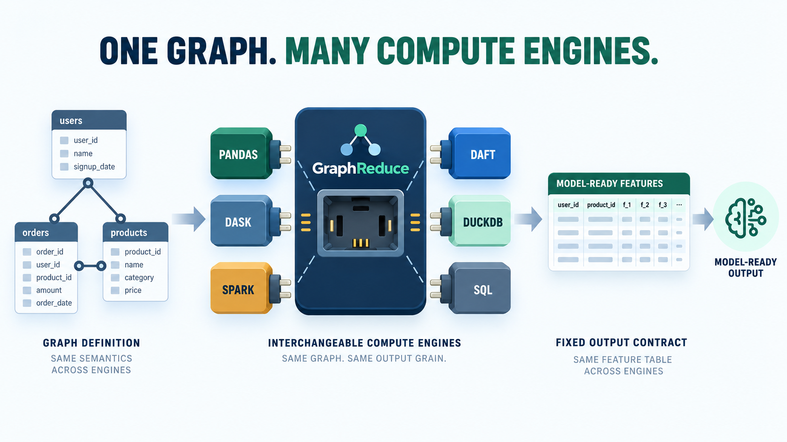

# Choose a Compute Layer

GraphReduce keeps the graph structure and node operations from the execution
engine. Switching engines is easiest when the graph uses `DynamicNode` and
automatic features; custom node methods remain backend-specific.



The graph topology, time-window configuration, and intended output grain form
the portable contract. Engine-specific expressions, clients, storage access,
and materialization behavior remain integration concerns.

## Backend map

| Workload | `ComputeLayerEnum` | Typical node | Extra |
| --- | --- | --- | --- |
| pandas | `pandas` | `DynamicNode` | Core install |
| Dask | `dask` | `DynamicNode` | Core install |
| Spark | `spark` | `DynamicNode` | `graphreduce[spark]` |
| Daft | `daft` | `DynamicNode` | `graphreduce[daft]` |
| DuckDB | `duckdb` | `DuckdbNode` | `graphreduce[duckdb]` |
| SQLite | `sqlite` | `SQLNode` | Python standard library |
| Trino | `trino` | `TrinoNode` | `graphreduce[trino]` |
| Other SQL engines | Matching enum member | `SQLNode` or backend subclass | Backend client |

There is no generic `ComputeLayerEnum.sql`. Select the actual SQL dialect so
GraphReduce can render backend-specific syntax.

## Dataframe nodes

The same basic node configuration works across dataframe engines:

```python
from graphreduce.enum import ComputeLayerEnum
from graphreduce.node import DynamicNode

customers = DynamicNode(
    fpath="customers.parquet",
    fmt="parquet",
    pk="id",
    prefix="cust",
    compute_layer=ComputeLayerEnum.pandas,  # or dask, spark, or daft
)
```

Set the graph to the same compute layer:

```python
graph = GraphReduce(
    parent_node=customers,
    compute_layer=ComputeLayerEnum.pandas,
    auto_features=True,
)
```

Spark also needs `spark_sqlctx` where required by the current API. Storage
paths must be readable by the chosen engine; a local path that works in pandas
may not be visible to a distributed Spark job.

## SQL nodes

SQL execution uses `SQLNode` or a backend-specific subclass and the SQL entry
point:

```python
import duckdb

from graphreduce.enum import ComputeLayerEnum
from graphreduce.node import DuckdbNode

connection = duckdb.connect()

customers = DuckdbNode(
    fpath="customers",
    table_name="customers",
    fmt="sql",
    pk="id",
    prefix="cust",
    compute_layer=ComputeLayerEnum.duckdb,
    client=connection,
    columns=["id", "name"],
)

graph = GraphReduce(
    parent_node=customers,
    compute_layer=ComputeLayerEnum.duckdb,
    sql_client=connection,
)
graph.add_node(customers)
graph.do_transformations_sql()
```

Client construction, credentials, catalogs, and temporary-object behavior vary
by backend. Use the matching end-to-end example before porting a large graph.

## What is portable

Usually portable:

- graph topology and edge keys;
- parent-grain and time-window configuration;
- `DynamicNode` automatic feature intent; and
- basic aggregate semantics.

Usually backend-specific:

- custom dataframe expressions;
- custom SQL strings and functions;
- type coercion and timestamp syntax;
- identifier quoting;
- connection and catalog setup; and
- materialization/checkpoint behavior.

See [Same graph, multiple backends](end_to_end_examples/multi_backend_cust_notifications.md)
for side-by-side implementations.
